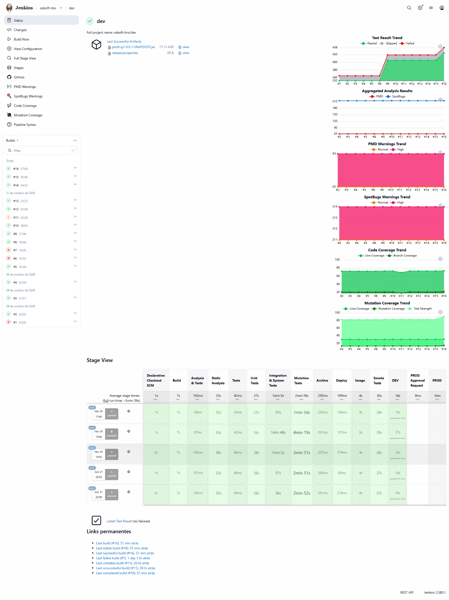
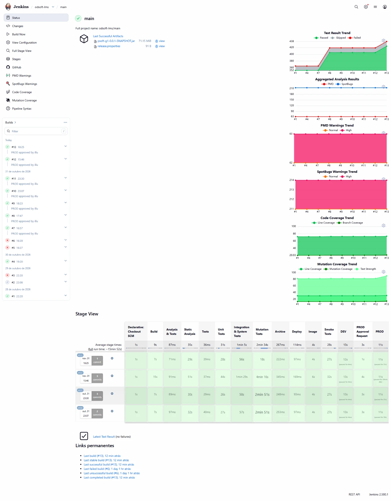

# System-to-be

Cada push corre um pipeline Jenkins que compila, analisa, testa e mede a qualidade. Só um build `SUCCESS` em `dev` ou `main` gera uma imagem Docker e faz deploy; PROD exige aprovação manual. Comparação com o estado inicial em [first-submission.md](../first-submission.md).

## 1. Pipeline (`Jenkinsfile`)

| Stage | Branches | O que faz |
|---|---|---|
| Build | Todas | `mvn clean compile` |
| Static Analysis | Todas, em paralelo com os testes | PMD e SpotBugs |
| Unit Tests | Todas | Surefire |
| Integration & System Tests | Todas | Failsafe e JaCoCo (todos os níveis) |
| Mutation Tests | Todas | PIT sobre os testes unitários |
| Archive | Todas | jar e `release.properties` (branch, build, commit, tag) |
| Image | `dev`, `main` | Imagem `psoft-g1:<branch>-<build>` com o commit lá dentro |
| Smoke Tests | `dev`, `main` | A imagem arranca num container descartável com os perfis `dev` e `prod` |
| DEV | `dev`, `main` | Deploy em `app-dev`, com rollback se falhar |
| PROD | `main` | Email, aprovação manual (expira em 1 dia), deploy em `app-prod` com rollback |

Um quality gate falhado deixa o build `UNSTABLE`, e o deploy não corre:

| Quality gate | Mínimo | Atual |
|---|---:|---:|
| Linhas (JaCoCo) | 70% | 73,2% |
| Branches (JaCoCo) | 20% | 21,9% |
| Mutation coverage (PIT) | 12% | 15% |
| Problemas novos de PMD e SpotBugs | 0 | |

## 2. Deploy

Por problemas técnicos com as VMs, os ambientes correm numa só máquina:

| Planeado | Implementado | Porta | Perfil | Dados |
|---|---|---:|---|---|
| `VM_JENKINS` | Jenkins | 8080 | | |
| `VM_DEV` | Docker Compose `app-dev` | 8081 | `dev` + `bootstrap` | Dados de exemplo |
| `VM_PROD` | Docker Compose `app-prod` | 8082 | `prod` | Vazio |

- A mesma imagem é promovida de DEV para PROD; só mudam as variáveis `SPRING_PROFILES_ACTIVE`, `APP_PORT` e `IMAGE_TAG`.
- Depois de cada deploy, o pipeline confirma `/actuator/health` e o commit em `/api/public/environment`; se falhar, volta à imagem anterior.
- Um `lock` por ambiente impede deploys em simultâneo.

## 3. Estratégia de testes

| Nível | Testes | Peso | Objetivo | Doubles |
|---|---:|---:|---|---|
| Unitário (`unit/`) | 320 | 73% | Uma classe isolada | Mockito e fakes |
| Integração (`integration/`) | 104 | 24% | Camadas reais em conjunto (H2, Spring MVC, Security) | Só `@MockBean` para isolar uma camada |
| Sistema (`system/`) | 14 | 3% | Fluxos completos pela API; fazem de e2e, porque não há frontend | Nenhum |

- Caixa opaca por defeito (classes de equivalência, valores-limite, casos negativos); caixa transparente só para lógica interna, com o critério indicado.
- Defeitos encontrados ficam num teste `@Disabled("Known defect: ...")` até serem corrigidos.
- Fora de âmbito: desempenho, carga e stress; usabilidade não se aplica.

## 4. Decisões

| Decisão | Alternativa | Porquê | Custo |
|---|---|---|---|
| Pipeline multibranch no repositório | Jobs configurados na UI | Versionado com o código; todas as branches recebem feedback | Depende de plugins do Jenkins |
| Uma máquina, uma porta por ambiente | Três VMs | Problemas técnicos com as VMs | Jenkins, DEV e PROD partilham recursos |
| Docker Compose, um projeto por ambiente | Correr o jar diretamente | Mesma imagem em todos os ambientes, isolamento, rollback por tag | Exige Docker |
| H2 em memória | Outra base de dados | Evita novas implementações no projeto; é a mesma dos testes | Os dados perdem-se a cada deploy ou restart |
| Nível do teste pela pasta | Pelo sufixo do nome | Nível explícito; testes com Spring deixam de correr como unitários | É preciso pôr cada teste na pasta certa |
| Gates como `UNSTABLE` que bloqueia o deploy | `FAILURE` | Os relatórios são publicados na mesma, mas nada é implantado | Os mínimos têm de subir à medida que os testes melhoram |
| PMD e SpotBugs contam só problemas novos | Contar o total | Nenhum problema novo entra; os antigos não bloqueiam | Os antigos (63 PMD, 214 SpotBugs) continuam por corrigir |
| PIT só com os unitários | Incluir os de integração | Com o Spring a arrancar por mutante, o stage seria muito mais lento | Controllers aparecem com mutation baixa |
| Smoke tests antes de qualquer ambiente | Só health check após o deploy | Erros de configuração apanhados sem tocar em DEV nem PROD | Mais dois containers por build |
| Aprovação manual com email para PROD | Deploy automático | Uma pessoa decide quando promover | Depende de alguém disponível e do SMTP |

## 5. Métricas do pipeline

Jenkins 2.580.1, de 28-10-2026 a 01-11-2026: branch `dev` (builds #1 a #16) e branch `main` (builds #1 a #13).

Duração média por stage na branch `dev` até 31-10-2026, antes das melhorias da secção 6:

| Stage | Duração média | Peso |
|---|---:|---:|
| Checkout e Build | 8 s | 3% |
| Static Analysis, em paralelo com os testes | 33 s | |
| Unit Tests | 27 s | 9% |
| Integration & System Tests | 57 s | 18% |
| Mutation Tests | 2 min 52 s | 54% |
| Image | 4 s | 1% |
| Smoke Tests | 27 s | 9% |
| DEV | 13 s | 4% |
| **Total** | **cerca de 5 min 17 s** | |

- **Resultado dos builds:** em `dev`, 12 `SUCCESS`, 1 `UNSTABLE` e 3 falhados. Em `main`, 9 `SUCCESS`, 3 falhados e 1 abortado.
- **Deploys em PROD:** os builds #7 a #13 de `main` foram implantados em PROD, cada um com a aprovação registada ("PROD approved by illu"). Os stages comuns têm as mesmas durações em `main`; o total médio sobe para cerca de 6 min 9 s com o email de aprovação (3 s), o deploy em PROD (11 s) e a espera pela aprovação (59 s no build #10 e 21 s no #11).
- **Quality gate em ação:** o build #11 ficou `UNSTABLE` no commit que excluía o `bootstrapping` do JaCoCo. A cobertura desceu abaixo dos mínimos (linhas cerca de 68%, branches cerca de 18%), e o deploy não correu. O build #12 repôs a configuração e voltou a `SUCCESS`.
- **Tendências:** os testes passaram de 352 para 419 no build #9 de `dev` e para 438 no #16; PMD (63) e SpotBugs (214) mantiveram-se sem problemas novos.
- **Antes:** não havia pipeline; o build era manual (`mvn clean package`, 7,2 s, sem relatórios de qualidade nem deploy). **Agora:** cada push tem feedback completo e deploy em DEV em cerca de 5 minutos.
- **Bottleneck:** o Mutation Tests ocupa mais de metade do pipeline e corre depois dos testes.

## 6. Melhorias a partir das métricas

| Melhoria | Antes | Depois |
|---|---:|---:|
| PIT com 4 threads (`<threads>4</threads>`), execução local completa com compilação | não medido | 30 s |
| PIT com análise incremental (`<withHistory>true</withHistory>`), execução seguinte | 30 s | 16 s |
| Testes unitários | 301 | 320 |
| Mutantes mortos | 407 | 456 |
| Mutantes sobreviventes | 86 | 48 |
| Test strength | 83% | 90% |

Duração do stage Mutation Tests no Jenkins:

| Build | Configuração do PIT | Duração |
|---|---|---:|
| `dev` #14, `main` #11 | Sem threads nem histórico | 2 min 51 s |
| `dev` #15, `main` #12 | Primeira execução com 4 threads e histórico, mais 19 testes | 4 min 19 s e 4 min 16 s |
| `dev` #16 | Com o histórico do build anterior | 1 min 58 s |
| `main` #13 | Com o histórico do `dev` #16, mesmo código | 18 s |

- **PIT mais rápido:** depois da primeira execução, o stage passou de 2 min 51 s para 1 min 58 s (menos 31%). Em `main` desceu para 18 s, porque reaproveitou o histórico criado pelo build de `dev` com o mesmo código.
- **Primeira execução mais lenta (4 min 19 s):** a causa não está confirmada. Nessa execução não havia histórico, foi criado o ficheiro e correram 19 testes novos; outra hipótese é a máquina do Jenkins não ter 4 núcleos livres. Fica por medir com mais builds.
- **Mais mutantes mortos:** os testes novos cobrem a regra foto/URI com as 4 combinações, verificam os valores devolvidos pelos serviços (antes só eram chamados) e usam stubs com listas não vazias, valores-limite e consentimentos a `true` e a `false`.
- **Sobreviventes que ficam:** 7 dependem de defeitos conhecidos (só morrem quando forem corrigidos), cerca de 9 são equivalentes (não mudam o comportamento observável) e os restantes são getters gerados pelo Lombok nos DTOs.
- **Mutation coverage sobe pouco (13% para 15%):** 58% dos mutantes estão no `equals` e no `hashCode` gerados pelo Lombok, que nenhum teste corre. A test strength é a medida relevante aqui.

## 7. Limitações

- Não há ambiente de staging.
- PROD usa H2 em memória: serve para demonstrar o processo, não para guardar dados.
- Margens pequenas nos gates de branches e de mutation.
- O histórico do PIT fica num ficheiro da pasta temporária, partilhado pelos jobs `dev` e `main`. É isso que torna o `main` #13 tão rápido, mas dois builds em simultâneo podem usar o mesmo ficheiro.
